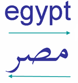
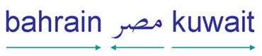
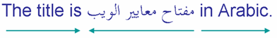
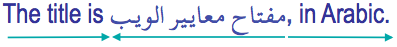
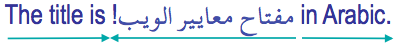
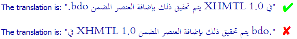
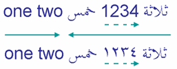
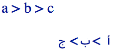

# أساسيات خوارزمية الترميز الموحد ثنائية الاتجاه

## ما هو الترميز الموحد (يونيكود)؟

هو معيار عالمي لترميز النصوص، أشهر ترميز يونيكود هو UTF-8.

## ماذا تفعل خوارزمية الترميز الموحد ثنائية الاتجاه؟

من المهم فهم أن في كل متصفحات الويب الكبيرة، ترتيب الأحرف في الذاكرة (الترتيب المنطقي) ليس كترتيبها المرئي.

مجموعة القواعد المطبقة من المتصفح لإنتاج الترتيب المرئي الصحيح تعرف ب**خوارزمية الترميز الموحد ثنائية الاتجاه**. او **الخوارزمية ثنائية الاتجاه** للاختصار.

نعلم أن السلسلة من الحروف اللاتينية تعرض واحدة تلو الإخرى من اليسار إلى اليمين، في الجانب الإخر، الخوارزمية ثنائية الاتجاه ستعرض سلسلة من الحروف العربية من اليمين الى اليسار.

كيف يعلم المتصفح أن السلسلة تكتب من اليسار إلى اليمين أم من اليمين إلى اليسار؟ ذلك لأن كل حرف في الترميز الموحد يملك خاصية اتجاهية أما أنه يكتب من اليمين إلى اليسار أو أنه يكتب من اليسار إلى اليمين.
الحروف من اللغات التي تكتب من اليمين إلى اليسار كالعربية تعرض من اليمين إلى اليسار بالخوارزمية ثنائية الاتجاه، والحروف من اللغات التي تكتب من اليسار إلى اليمين تعرض من اليسار إلى اليمين في الخوارزمية ثنائية الاتجاه.
سلسلة من الحروف العربية ستعرض من اليمين إلى اليسار. هذا مستقل عن الاتجاه الأساسي.

## المقاطع الاتجاهية

حين يمزج نص باتجاه مختلف، تنتج الخوارزمية ثنائية الاتجاه مقطعًا اتجاهيًّا منفصلا لكل سلسلة من الحروف بنفس الاتجاه.

في الصورة التالية توجد ثلاث مقاطع اتجاهية:

## الاتجاه الأساسي

ترتيب عرض النص يعتمد على الاتجاه الأساسي المعين للجملة او الفقرة التي تحتويه. الاتجاه الأساسي يصنع سياقًا اتجاهيًّا لكي تقرر الخوارزمية ثنائية الاتجاه كيفية التعامل مع النص في مواضع مختلفة.

في لغة HTML الاتجاه الأساسي يحدد أما بوراثة الاتجاه الأساسي للعنصر الأب الذي يمتلك الصفة dir (اتجاه)، وفي حالة عدم وجود تلك الصفة ترث الاتجاه الافتراضي للمستند وهو من اليسار إلى اليمين، وأما بتعيين الاتجاه يدويا:

`dir="ltr"` (من اليسار إلى اليمين)

`dir="rtl"` (من اليمين إلى اليسار)

`dir="auto"` (تلقائي حسب السياق)

في المثال أدناه، الاتجاه الأساسي هو من اليسار إلى اليمين، حيث تقرأ bahrain ثم مصر ثم kuwait.

هنا نفس الجملة مع عكس الاتجاه الأساسي، حيث تقرأ bahrain ثم مصر ثم kuwait كالمرة الماضية لكنها تعرض بعكس الاتجاه:

الأحرف في الحالتين مخزونة في الذاكرة بالترتيب ذاته، لكن ترتيب عرض المقاطع الاتجاهية معكوس.

## الأحرف المحايدة

بعض الأحرف كالمسافات وبعض علامات التنقيط ليست من اليمين إلى اليسار أو من اليسار إلى اليمين، لأنه يمكن استخدامها في لغات تكتب من اليمين إلى اليسار وفي لغات تكتب من اليسار إلى اليمين، لهذا تسمى أحرف **محايدة** او **ضعيفة**.

حين تجد الخوارزمية ثنائية الاتجاه حروفًا محايدة، فإنها تحدد اتجاههم بالنظر إلى الأحرف المجاورة.

حرف محايد بين حرفين ذوا نفس الاتجاه سيتخذ ذلك الاتجاه أيضا. فحرف محايد بين حرفين عربيين سيعامل كحرف من اليمين إلى اليسار، وسيمدد المقطع الاتجاهي. لهذا الكلمات العربية الثلاث أدناه تقرأ من اليمين إلى اليسار مع المسافتين الاثنين، التي تتخذ اتجاه الحرفين العربيين على جانبيها.

حتى لو كانت هناك حروف عديدة محايدة بين حرفين ذوي اتجاه، ستتخذ كلها نفس الاتجاه.

لكن ماذا يحدث حين يقع حرف محايد بين حرفين ذوي اتجاهين متعاكسين؟ في هذه الحالة، الحرف او الأحرف المحايدة سيصبح اتجاهها مثل الاتجاه الأساسي.

كمثال، لو وضعنا الفاصلة الإنكليزية (,) وهو حرف محايد بعد حرف عربي في المثال أدناه سيعتبر حرف من اليسار إلى اليمين اتباعًا للاتجاه الأساسي وسيعرض إلى يمين النص العربي كجزء من المقطع الاتجاهي إلى اليمين.

لكن هذا الشيء ليس جيدًا دائمًا، كما سنرى لاحقا.

## تضمين تغييرات في الاتجاه الأساسي

في المثال السابق، لو انتهى النص العربي بعلامة تعجب، لتوقعنا عرض علامة التعجب يسار النص العربي.

لكنه لن يعرض النص هكذا. علامة التعجب ستعامل كالفاصلة الإنكليزية وتعرض إلى يمين النص العربي.

لتصحيح هذا، نحتاج لتحديد الاتجاه الأساسي للنص العربي وعلامة التعجب من اليمين إلى اليسار، فستفترض علامة التعجب (المحايدة) اتجاها من اليمين إلى اليسار وستعامل كتكملة للنص العربي وتعرض يساره.

لغة التأشير أو التطبيق المستخدم يجب أن يوفر طريقة لفعل هذا (مثل تغيير صفة dir في HTML)

ليس تغيير الاتجاه الأساسي مهم فقط في التعامل مع علامات التنقيط، لكنه مهم للتأكد من الترتيب الصحيح للمقاطع الاتجاهية في النصوص ثنائية الاتجاه. في المثال التالي السطر الأعلى يظهر العرض المتوقع، أما السطر الأسفل يظهر العرض الافتراضي من دون تغيير في الاتجاه الأساسي.

من دون تغيير الاتجاه الأساسي، المقاطع الاتجاهية سترتب من اليسار إلى اليمين. لتصحيح هذا يجب تحديد الاتجاه الإساسي من اليمين إلى اليسار.

## الأرقام

الأرقام في اللغات التي تكتب من اليمين إلى اليسار تكتب من اليسار إلى اليمين كالأرقام في اللغات التي تكتب من اليسار إلى اليمين. تعامل الأرقام بشكل مختلف من الكلمات. للأرقام اتجاهية ضعيفة من اليسار إلى اليمين. المثالان أدناه يوضحان هذا الفرق.

لأن اتجاهية الأرقام ضعيفة، فيعتبر الرقم كجزء من النص العربي السابق، بالرغم من أن الأرقام تعرض من اليسار إلى اليمين، فالكلمتان العربيتان المحيطتان بالأرقام تعامل كجزء من نفس المقطع الاتجاهي.

بجانب الرقم قد توجد رموز محايدة معينة كرموز العملات، ستعامل هذه الرموز كجزء من الرقم. هناك فروق طفيفة في طريقة التعامل مع الأرقام، لكننا لا نحتاج هنا لنقاشهة بالتفاصيل.

## الأحرف المعكوسة

سترى أن لبعض الحروف أشكالًا معكوسة حسب اتجاه النص التي توجد فيه.

المثال أدناه يستخدم نفس الرمز في السطرين، لكنه يؤشر إلى اليمين بجانب النصوص التي تكتب من اليسار إلى اليمين، ويؤشر إلى اليسار بجانب النصوص التي تكتب من اليمين إلى اليسار.

هناك عدة حروف كهذه، لا سيما التي تكون أزواجًا كالأقواس، وبعضها تكون منفردة.

## المصدر

[https://www.w3.org/International/articles/inline-bidi-markup/uba-basics](https://www.w3.org/International/articles/inline-bidi-markup/uba-basics)
